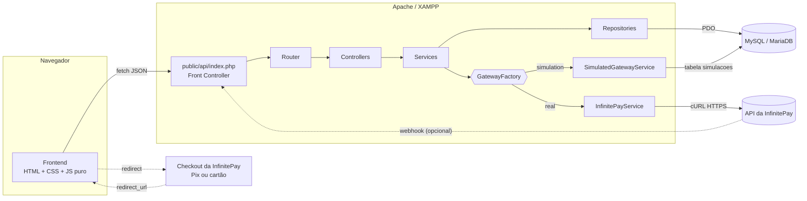
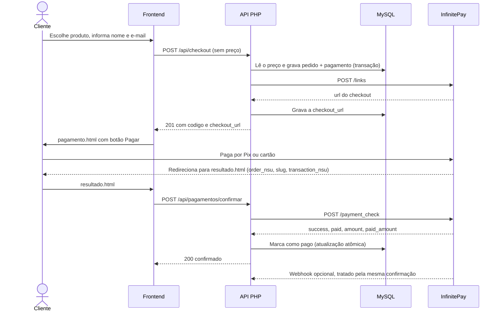
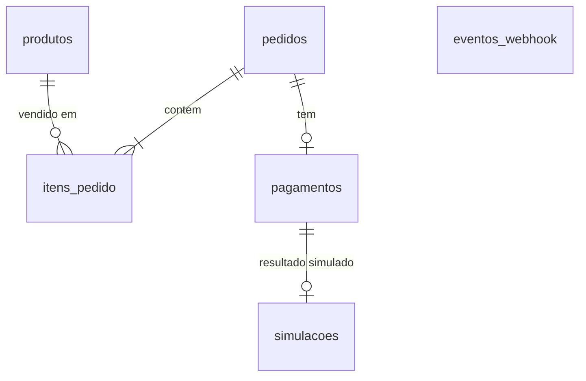

# Checkout Web com PHP, MySQL e InfinitePay

Aplicação web que simula uma loja e integra um sistema próprio de pedidos à API de **Checkout Integrado da InfinitePay**. O cliente escolhe um produto, é levado ao checkout seguro da InfinitePay (Pix ou cartão) e, ao voltar, o **backend** consulta a API oficial para confirmar o pagamento. Voltar à página de sucesso, por si só, nunca marca um pedido como pago.

Projeto acadêmico da disciplina **Construção e Integração de APIs RESTful com Padrões de Projeto** (Faculdade Senac PR).

- **Autor:** _preencha com seu nome_
- **URL local:** `http://localhost/checkout-infinitepay/`

## Sumário

1. [Visão geral](#1-visão-geral)
2. [Tecnologias](#2-tecnologias)
3. [Início rápido](#3-início-rápido)
4. [Configuração (.env)](#4-configuração-env)
5. [Como demonstrar](#5-como-demonstrar)
6. [Arquitetura](#6-arquitetura)
7. [Fluxo de pagamento](#7-fluxo-de-pagamento)
8. [Documentação da API](#8-documentação-da-api)
9. [Banco de dados](#9-banco-de-dados)
10. [Segurança](#10-segurança)
11. [Testes (Postman)](#11-testes-postman)
12. [Integração com a InfinitePay: o que foi verificado e limitações](#12-integração-com-a-infinitepay-o-que-foi-verificado-e-limitações)
13. [Solução de problemas](#13-solução-de-problemas)
14. [Scripts utilitários](#14-scripts-utilitários)

---

## 1. Visão geral

A aplicação tem **dois modos de pagamento**, escolhidos pela variável `PAYMENT_MODE` no `.env`:

| Modo | O que faz | Dinheiro |
|---|---|---|
| `simulation` (padrão) | Usa um checkout falso (`simulador.html`) em que você escolhe aprovado, recusado, pendente ou valor divergente. | Nenhum |
| `real` | Cria links reais na InfinitePay e consulta o pagamento pela API oficial. | **Real** (mínimo R$ 1,00) |

A InfinitePay **não oferece sandbox**. Por isso o modo de simulação existe e fica separado da integração real: os dois implementam a mesma interface (`PaymentGateway`) e o restante do código não percebe a diferença.

O que a aplicação garante:

- O **preço é sempre lido do banco**. O navegador nunca envia valores.
- Um pedido só vira `pago` depois que o backend consulta o provedor e confere que o valor confirmado é o total do pedido.
- Confirmar o mesmo pagamento várias vezes não duplica nada (idempotência).
- Dados de cartão nunca passam por esta aplicação: ficam no ambiente da InfinitePay.

## 2. Tecnologias

| Camada | Tecnologia |
|---|---|
| Frontend | HTML5, CSS3, JavaScript puro (Fetch API) |
| Backend | PHP 8 ou superior, Apache (XAMPP), PHP cURL, PDO |
| Banco | MySQL / MariaDB (XAMPP), phpMyAdmin |
| Ferramentas | Visual Studio Code, Postman, Git |

Sem Composer, sem frameworks e sem dependências externas.

Ambiente em que foi desenvolvido: Windows, XAMPP com PHP 8.3.36, Apache 2.4.65 e MariaDB 10.11.16.

## 3. Início rápido

Requisitos: XAMPP com Apache e MySQL, PHP 8+ com as extensões `curl`, `pdo_mysql`, `mbstring` e `openssl`, e o módulo `mod_rewrite` do Apache (já vem ativo no XAMPP).

**1. Copie o projeto** para a pasta do Apache:

```powershell
cd C:\xampp\htdocs
git clone <url-do-repositorio> checkout-infinitepay
cd checkout-infinitepay
```

**2. Inicie o Apache e o MySQL** no XAMPP Control Panel.

**3. Crie o banco** (o script é seguro para rodar mais de uma vez):

```powershell
C:\xampp\mysql\bin\mysql.exe -u root --default-character-set=utf8mb4 -e "source C:/xampp/htdocs/checkout-infinitepay/database/schema.sql"
```

Alternativa: no phpMyAdmin, aba **Importar**, arquivo `database/schema.sql`.

**4. Crie o arquivo de configuração:**

```powershell
Copy-Item .env.example .env
```

Para o modo de simulação, o `.env` padrão já serve (se o `root` do seu MySQL tiver senha, preencha `DB_PASS`).

**5. Valide o ambiente:**

```powershell
C:\xampp\php\php.exe scripts\check-config.php
C:\xampp\php\php.exe scripts\check-db.php
```

Os dois devem terminar com `Resultado: sem erros.`

**6. Abra** `http://localhost/checkout-infinitepay/`.

## 4. Configuração (.env)

O arquivo `.env` **nunca** vai para o Git (está no `.gitignore`). O modelo sem segredos é o `.env.example`.

| Variável | Para que serve | Exemplo |
|---|---|---|
| `APP_ENV` | `local` mostra detalhes de erro só no log | `local` |
| `APP_URL` | Endereço base da aplicação (sem barra final) | `http://localhost/checkout-infinitepay` |
| `PAYMENT_MODE` | `simulation` ou `real` | `simulation` |
| `DB_HOST`, `DB_PORT` | Servidor do banco | `127.0.0.1`, `3306` |
| `DB_NAME` | Nome do banco | `checkout_infinitepay` |
| `DB_USER`, `DB_PASS` | Credenciais do banco | `root`, (vazia) |
| `INFINITEPAY_HANDLE` | Sua InfiniteTag, **sem o `$`** | `sua-handle` |
| `INFINITEPAY_API_KEY` | Chave secreta (começa com `inchk_`) | _só no seu `.env`_ |
| `INFINITEPAY_BASE_URL` | Base da API | `https://api.checkout.infinitepay.io` |
| `INFINITEPAY_TIMEOUT` | Timeout das chamadas, em segundos | `15` |
| `INFINITEPAY_WEBHOOK_URL` | URL HTTPS pública do webhook (opcional) | _vazia sem túnel_ |

Depois de editar o `.env`, rode `scripts\check-config.php`. Ele valida tudo **sem exibir nenhum segredo**.

> Ao trocar o modo, altere somente o valor. Escrever `PAYMENT_MODE=PAYMENT_MODE=simulation` faz a API responder 500.

## 5. Como demonstrar

### Modo simulação (sem dinheiro)

1. Confirme `PAYMENT_MODE=simulation` (`GET /api/ping` mostra o modo).
2. Abra a loja, clique em **Comprar** e preencha nome e e-mail (dados fictícios).
3. Na tela de pagamento, observe o selo amarelo **SIMULAÇÃO** e clique em **Pagar com InfinitePay**.
4. No checkout simulado, escolha o resultado:

| Escolha | O que acontece |
|---|---|
| Pix aprovado | Pedido `pago`, método Pix |
| Cartão aprovado | Pedido `pago`, valor pago 3% maior (taxa ilustrativa) |
| Recusado / Pendente | Pedido continua `pendente` |
| Aprovado com valor diferente | Backend recusa (409) e o pedido **não** vira pago |

5. Na tela de resultado, aperte `F5`: a confirmação repetida não duplica nada.

### Modo real (R$ 1,00 de verdade)

Requisitos na conta InfinitePay: **Checkout Integrado habilitado**, **handle**, **API Key** e **uma chave Pix cadastrada** (sem ela, o checkout mostra "Não foi possível gerar o QR Code Pix"; o cadastro é feito no app, em "Área Pix").

1. No `.env`: `PAYMENT_MODE=real`, mais `INFINITEPAY_HANDLE` e `INFINITEPAY_API_KEY`.
2. Rode `scripts\check-config.php` e confirme que `GET /api/ping` mostra `real`.
3. Compre o **Produto de teste (R$ 1,00)** e pague por Pix ou cartão.
4. Clique em **Continuar** na InfinitePay. O navegador volta para `resultado.html`, e o backend confirma pelo `payment_check`.
5. O estorno é feito pelo app ou pela conta web da InfinitePay.

Volte para `PAYMENT_MODE=simulation` depois dos testes reais.

## 6. Arquitetura



### Camadas e padrões de projeto

| Padrão | Onde | Responsabilidade |
|---|---|---|
| Front Controller | `public/api/index.php` | Ponto único de entrada de toda rota `/api/...` |
| Router | `src/Core/Router.php` | Associa método e caminho ao handler |
| Controller | `src/Controllers/` | Recebe a requisição HTTP e devolve a resposta |
| Service | `src/Services/` | Regras de negócio e comunicação com o provedor |
| Repository | `src/Repositories/` | Todo o SQL (PDO com prepared statements) |
| Strategy | `PaymentGateway` | Contrato comum do gateway real e do simulado |
| Factory | `GatewayFactory` | Escolhe o gateway conforme `PAYMENT_MODE` |

### Estrutura de diretórios

```text
checkout-infinitepay/
├── .htaccess              Redireciona tudo para public/ (código interno fica inacessível)
├── .env.example           Modelo de configuração, sem segredos
├── .gitignore
├── README.md
├── database/
│   └── schema.sql         Tabelas, relacionamentos e produtos de exemplo
├── docs/                  Modelo lógico do banco e evidências dos testes
├── logs/                  Log de erros (ignorado pelo Git)
├── public/                ÚNICO diretório acessível pelo navegador
│   ├── index.html         Loja
│   ├── pagamento.html     Resumo do pedido e botão de pagar
│   ├── resultado.html     Resultado confirmado pelo backend
│   ├── simulador.html     Checkout falso (só no modo simulation)
│   ├── css/  js/  img/
│   └── api/index.php      Front Controller
├── scripts/               Verificações de ambiente e sonda da API real
└── src/
    ├── bootstrap.php      Autoload, .env, fuso horário e log de erros
    ├── routes.php         Tabela de rotas
    ├── Core/              Env, Database, Request, Response, Router, Uuid, HttpException
    ├── Controllers/       Checkout, Pagamento, Pedido, Produto, Simulador, Webhook
    ├── Services/          Checkout, Pagamento, Pedido, Simulador, Webhook,
    │                      PaymentGateway, GatewayFactory, InfinitePayService,
    │                      SimulatedGatewayService, GatewayException
    └── Repositories/      Produto, Pedido, Pagamento, Simulacao, EventoWebhook
```

## 7. Fluxo de pagamento



### Estados do pedido

| Status | Quando |
|---|---|
| `pendente` | Pedido criado, aguardando pagamento |
| `pago` | O backend confirmou pelo provedor e o valor confere |
| `falhou` | O provedor estava indisponível ao criar o checkout |
| `cancelado` | Reservado para uso futuro (hoje nenhum fluxo grava este valor) |

## 8. Documentação da API

URL base: `http://localhost/checkout-infinitepay`

### Convenções

- Corpo e resposta em **JSON** (`Content-Type: application/json`). A exceção é o webhook, que aceita qualquer `Content-Type`.
- Sucesso: `{"dados": ...}`. Erro: `{"erro": {"codigo": "...", "mensagem": "...", "detalhes": {...}}}` (`detalhes` só quando há erro por campo).
- Valores em **centavos** (inteiros). Os tipos são estritos: `"produto_id": "1"` (texto) é recusado.
- Erros inesperados viram `500` com mensagem genérica. Os detalhes ficam só em `logs/php-error.log`.
- No modo `simulation`, o cabeçalho `X-Simulacao: indisponivel` faz o gateway falhar de propósito. No modo `real` ele é ignorado.

| Método | Rota | Finalidade |
|---|---|---|
| GET | `/api/ping` | Saúde da API e modo de pagamento |
| GET | `/api/produtos` | Lista produtos ativos |
| POST | `/api/checkout` | Cria pedido e link de checkout |
| GET | `/api/pedidos/{codigo}` | Consulta pedido e pagamento |
| POST | `/api/pagamentos/confirmar` | Confirma o pagamento pelo provedor |
| POST | `/api/webhooks/infinitepay` | Recebe notificações da InfinitePay |
| POST | `/api/simulador/resolver` | Escolhe o resultado no checkout simulado (**só em `simulation`**) |

### GET /api/ping

```json
{"dados":{"status":"ok","modo_pagamento":"simulation","hora_servidor":"2026-11-22T11:40:25-03:00"}}
```

### GET /api/produtos

Resposta `200`:

```json
{"dados":[
  {"id":1,"slug":"caneca-aurora","nome":"Caneca Aurora","descricao":"Caneca de cerâmica de 350 ml com acabamento fosco.","imagem_url":"img/caneca-aurora.svg","preco_centavos":4990}
]}
```

### POST /api/checkout

Cria o pedido e o pagamento numa transação, calcula o total **a partir do banco** e pede o link ao gateway.

Requisição:

```json
{"produto_id":1,"quantidade":2,"comprador":"Maria Silva","email":"maria@example.com"}
```

| Campo | Regra |
|---|---|
| `produto_id` | Inteiro positivo, de um produto ativo |
| `quantidade` | Inteiro de 1 a 99 (padrão 1) |
| `comprador` | 2 a 120 caracteres, sem caracteres de controle |
| `email` | E-mail válido, até 160 caracteres |

Campos extras, como `preco_centavos`, são **ignorados**.

Resposta `201`:

```json
{"dados":{
  "codigo":"58270e19-24ab-465c-a057-360e0625132e",
  "status":"pendente",
  "total_centavos":9980,
  "itens":[{"produto_id":1,"nome":"Caneca Aurora","quantidade":2,"preco_unitario_centavos":4990}],
  "pagamento":{"modo":"simulado","status":"pendente",
    "checkout_url":"http://localhost/checkout-infinitepay/simulador.html?pedido=58270e19-24ab-465c-a057-360e0625132e"}
}}
```

| Status | `codigo` | Quando |
|---|---|---|
| 400 | `json_invalido`, `corpo_vazio` | Corpo malformado ou vazio |
| 413 | `corpo_grande_demais` | Corpo acima de 64 KB |
| 415 | `tipo_nao_suportado` | Sem `Content-Type: application/json` |
| 422 | `dados_invalidos` | Validação (campo a campo em `detalhes`) |
| 503 | `gateway_indisponivel` | Provedor fora do ar (pedido fica `falhou`) |

Exemplo de `422`:

```json
{"erro":{"codigo":"dados_invalidos","mensagem":"Os dados enviados são inválidos.",
 "detalhes":{"quantidade":"A quantidade deve ser um número inteiro entre 1 e 99."}}}
```

### GET /api/pedidos/{codigo}

O `codigo` é o UUID devolvido no checkout. Não expõe e-mail, nome do comprador nem ids internos. A `checkout_url` só aparece enquanto o pagamento ainda pode ser feito.

```json
{"dados":{
  "codigo":"24e015a0-0c4a-4cd4-a3c3-0696e924a558",
  "status":"pendente",
  "total_centavos":100,
  "criado_em":"2026-11-22T10:39:47-03:00",
  "itens":[{"produto_id":3,"nome":"Produto de teste (R$ 1,00)","quantidade":1,"preco_unitario_centavos":100}],
  "pagamento":{"modo":"simulado","status":"pendente","metodo":null,"valor_pago_centavos":null,"checkout_url":"..."}
}}
```

`404 nao_encontrado` para código inexistente ou malformado (a resposta é a mesma, de propósito).

### POST /api/pagamentos/confirmar

Recebe os parâmetros da `redirect_url`, mas **eles não decidem nada**: o backend consulta o gateway e só então marca como pago.

```json
{"order_nsu":"<uuid do pedido>","transaction_nsu":"<id da transação>","slug":"<código da fatura>"}
```

Resposta `200`:

```json
{"dados":{"codigo":"82c44bf1-d017-4b93-bbe2-77122356af08","status":"pago","confirmado":true,"ja_confirmado":false,
 "total_centavos":100,"pagamento":{"status":"pago","metodo":"pix","valor_pago_centavos":100}}}
```

| Situação | Resposta |
|---|---|
| Confirmado agora | `200`, `confirmado: true`, `ja_confirmado: false` |
| Mesma confirmação repetida | `200`, `confirmado: true`, `ja_confirmado: true` |
| Provedor não confirmou (pendente, recusado, identificadores que não batem) | `200`, `confirmado: false`, pedido continua `pendente` |
| Valor confirmado diferente do total | `409 valor_divergente` (pedido **não** vira pago) |
| Pedido já pago com outra transação | `409 transacao_divergente` |
| Transação já usada em outro pedido | `409 transacao_ja_utilizada` |
| Pedido inexistente | `404 pedido_nao_encontrado` |
| Pedido sem checkout (falhou ao criar) | `409 pedido_sem_checkout` |
| Dados inválidos | `422 dados_invalidos` |
| Provedor indisponível | `503 gateway_indisponivel` |

### POST /api/webhooks/infinitepay

A InfinitePay chama este endpoint. Como o webhook **não tem assinatura**, nada do corpo é confiável: só `order_nsu`, `transaction_nsu` e `invoice_slug` são extraídos e passam pela mesma confirmação (`payment_check`). Valores como `amount` e `receipt_url` do corpo são ignorados.

| Situação | Resposta |
|---|---|
| Confirmado ou já confirmado | `200 {"recebido":true,"processado":true}` |
| Pedido desconhecido ou conflito (ex.: valor divergente) | `200 {"recebido":true,"processado":false}` (repetir não resolve) |
| Provedor ainda não confirma | `400 nao_confirmado` (a InfinitePay tenta de novo) |
| Provedor indisponível | `503 gateway_indisponivel` (a InfinitePay tenta de novo) |
| Corpo inválido | `400 webhook_invalido` ou `json_invalido` |

Cada notificação de um pedido conhecido é registrada em `eventos_webhook`.

### POST /api/simulador/resolver

Só existe no modo `simulation` (no `real` responde `404`). Registra a escolha feita no checkout falso e devolve a `redirect_url` que a InfinitePay devolveria. **Não altera o status do pedido.**

```json
{"pedido":"<uuid>","resultado":"aprovado","metodo":"pix"}
```

| Campo | Valores |
|---|---|
| `resultado` | `aprovado`, `recusado`, `pendente`, `aprovado_valor_divergente` |
| `metodo` | `pix` ou `credit_card` (obrigatório nos resultados aprovados) |

Erros: `404 pedido_nao_encontrado`, `409 pedido_nao_simulado`, `409 pedido_sem_checkout`, `409 pedido_ja_pago`, `422 dados_invalidos`.

## 9. Banco de dados

Seis tabelas em MySQL/MariaDB, valores monetários em **centavos** (`INT UNSIGNED`).



O dicionário completo (colunas, tipos, chaves e restrições) está em [`docs/modelo-logico.md`](docs/modelo-logico.md), e o script em [`database/schema.sql`](database/schema.sql).

## 10. Segurança

| Requisito | Como foi atendido |
|---|---|
| Não confiar em preços do navegador | O frontend não envia preço. O backend lê o valor do banco e calcula o total |
| SQL Injection | PDO com prepared statements reais (`EMULATE_PREPARES` desligado) |
| Segredos fora do Git | `.env` ignorado. A API Key só existe no backend e nunca é impressa (`check-config.php` e a sonda a escondem) |
| Sem dados de cartão | O pagamento acontece no ambiente da InfinitePay |
| Pagamento só com confirmação confiável | O veredicto vem do `payment_check`. O valor confirmado precisa ser igual ao total do pedido |
| Idempotência | `UPDATE ... WHERE status <> 'pago'` (atômico), `UNIQUE` em `pagamentos.pedido_id` e em `transaction_nsu` |
| Webhook sem assinatura | O corpo nunca decide. Tudo passa por `payment_check` |
| Códigos de pedido não adivinháveis | UUID v4 público (o id sequencial nunca é exposto) |
| Código interno protegido | `.htaccess` na raiz serve apenas `public/`. Arquivos ocultos são bloqueados |
| Mensagens de erro | Genéricas para o cliente. Detalhes e códigos só no log, sem credenciais |
| XSS no frontend | Dados da API entram na página com `textContent`, nunca como HTML |
| Redirecionamentos | O frontend só segue para o mesmo servidor ou para `https://*.infinitepay.io`. O backend só aceita `checkout_url` HTTPS da InfinitePay |
| Transporte | Verificação de certificado SSL sempre ligada nas chamadas cURL. Cabeçalho `X-Powered-By` removido |

## 11. Testes (Postman)

Defina a variável de coleção `base = http://localhost/checkout-infinitepay` e use `Content-Type: application/json`. As capturas dos testes executados ficam em `docs/prints/`.

| # | Cenário | Requisição | Resultado esperado |
|---|---|---|---|
| 1 | Listar produtos | `GET {{base}}/api/produtos` | 200 com os produtos ativos |
| 2 | Pedido válido | `POST /api/checkout` com produto, quantidade, nome e e-mail | 201, `status` `pendente`, total calculado pelo servidor |
| 3 | Dados inválidos | `POST /api/checkout` com campos errados | 422 com `detalhes` por campo |
| 4 | Link na InfinitePay | Modo `real`, mesmo `POST /api/checkout` | 201 com `checkout_url` em `checkout.infinitepay.io` |
| 5 | Pedido existente | `GET /api/pedidos/{codigo}` | 200 com itens e pagamento |
| 6 | Pedido inexistente | `GET /api/pedidos/00000000-0000-4000-8000-000000000000` | 404 `nao_encontrado` |
| 7 | Pagamento aprovado | Simulador (`aprovado`, `pix`) e depois `POST /api/pagamentos/confirmar` | 200, `status` `pago`, `confirmado` `true` |
| 8 | Pendente ou recusado | Simulador (`pendente` ou `recusado`) e `confirmar` | 200, `confirmado` `false`, pedido `pendente` |
| 9 | API externa indisponível | `X-Simulacao: indisponivel` (simulation) ou URL base inválida (real) | 503 `gateway_indisponivel` |
| 10 | Repetição sem duplicar | Repetir `confirmar` e o webhook com os mesmos dados | 200 com `ja_confirmado` `true`, nenhum pagamento duplicado |

**Roteiro dos cenários 7 a 10 no Postman (modo simulation):**

1. `POST /api/checkout` e guarde o `codigo`.
2. `POST /api/simulador/resolver` com `{"pedido":"<codigo>","resultado":"aprovado","metodo":"pix"}` e guarde `transaction_nsu` e `slug`.
3. `POST /api/pagamentos/confirmar` com `{"order_nsu":"<codigo>","transaction_nsu":"...","slug":"..."}`.
4. Repita o passo 3 para ver `ja_confirmado: true`.
5. Para o webhook, envie o formato documentado: `{"invoice_slug":"<slug>","transaction_nsu":"...","order_nsu":"<codigo>"}` em `POST /api/webhooks/infinitepay`.

## 12. Integração com a InfinitePay: o que foi verificado e limitações

### Endpoints utilizados (documentação oficial)

| Endpoint | Uso |
|---|---|
| `POST https://api.checkout.infinitepay.io/links` | Cria o link. Corpo: `handle`, `order_nsu`, `items` (`quantity`, `price` em centavos, `description`), `redirect_url`, `customer`, `options` (`single_payment`, `valid_until`) e, opcionalmente, `webhook_url`. A chave vai no header `X-Api-Key` |
| `POST https://api.checkout.infinitepay.io/payment_check` | Consulta o pagamento. Corpo: `handle`, `order_nsu`, `transaction_nsu`, `slug`. Resposta: `success`, `paid`, `amount`, `paid_amount`, `installments`, `capture_method` |

A resposta do `POST /links` não está descrita na documentação. Em teste real, ela trouxe um único campo: `{"url": "..."}`.

### Verificado em teste real (uma execução, conta própria)

- Link criado com a handle e a API Key, e a página da InfinitePay abriu com o item e o valor corretos.
- Pagamento de **R$ 1,00 por Pix** concluído, confirmado pelo `payment_check` e gravado como `pago` (com `slug` e `transaction_nsu`).
- Repetir a confirmação não duplicou nada (`ja_confirmado`).
- O botão **Continuar** da InfinitePay devolveu o navegador para `localhost`.
- O campo `customer` pré-preencheu nome e e-mail.
- O `payment_check` respondeu sem enviar a API Key.
- Abrir o link depois de pago mostrou uma página de erro genérica da InfinitePay (compatível com `single_payment`, mas a página não explica o motivo).
- Sem chave Pix cadastrada na conta, o checkout mostrou "Não foi possível gerar o QR Code Pix".

### Não verificado

- **Entrega real do webhook**: exige uma URL HTTPS pública (túnel como ngrok ou Cloudflare Tunnel). A lógica foi testada apenas com notificações simuladas.
- Efeito de `valid_until` (expiração do link em 24 horas).
- Estorno: o app da InfinitePay estorna, mas o nosso banco continuaria `pago`, porque o evento `refunded` só chegaria pelo webhook.
- Pagamento por cartão no modo real.
- Duas confirmações realmente simultâneas.

### Limitações conhecidas

- **Sem sandbox** na InfinitePay: o modo `simulation` demonstra os cenários sem dinheiro.
- O `payment_check` só informa `paid` verdadeiro ou falso. Pendente e recusado são indistinguíveis por ele. A recusa só apareceria no evento `payment_failed` do webhook.
- Valor divergente responde `409` e não altera o pedido. Não existe um estado "em análise".
- Dois cliques seguidos em "Comprar" criam dois pedidos. O frontend desabilita o botão durante o envio, mas não há `Idempotency-Key`. A duplicidade de **pagamentos** é impedida pelo banco.
- O cartão sempre fica ativo no link. O Pix depende de a conta ter chave Pix.
- O status `cancelado` existe no banco, mas nenhum fluxo o grava hoje.

## 13. Solução de problemas

| Sintoma | Causa provável | O que fazer |
|---|---|---|
| `curl` em FALHA no Apache, mas funciona no terminal (`Unable to load dynamic library 'curl'` no `error.log`) | Falta uma DLL de dependência na pasta do Apache | Copie `C:\xampp\php\brotlidec.dll` para `C:\xampp\apache\bin\` e reinicie o Apache |
| `Failed to connect to localhost:80` | Apache parado | Inicie o Apache no XAMPP. Se não subir, outro programa (como o IIS) usa a porta 80 |
| API responde 500 `erro_interno` | Configuração, banco ou DLL | Leia `logs/php-error.log` |
| Log com `PAYMENT_MODE inválido` | Valor do `.env` errado (por exemplo, repetido) | Deixe exatamente `PAYMENT_MODE=simulation` ou `PAYMENT_MODE=real` |
| `Falha ao conectar ao banco (código 2002)` | MySQL parado | Inicie o MySQL |
| `código 1049` | Banco não criado | Rode o `schema.sql` |
| `código 1045` | Usuário ou senha do banco incorretos | Ajuste `DB_USER` e `DB_PASS` no `.env` |
| 404 em `/api/...` | `mod_rewrite` ou `AllowOverride` desligados | Confirme `AllowOverride All` e reinicie o Apache |
| "Não foi possível gerar o QR Code Pix" | A conta InfinitePay não tem chave Pix | Cadastre uma chave no app (Área Pix) |
| Imagens dos produtos quebradas | Falta algum SVG em `public/img/` | Confirme `caneca-aurora.svg`, `camiseta-orbit.svg` e `produto-teste.svg` |
| Erro vermelho "Undefined type" no VS Code | Índice do Intelephense desatualizado | `Ctrl+Shift+P`, **Developer: Reload Window** |

## 14. Scripts utilitários

Execute na raiz do projeto com `C:\xampp\php\php.exe scripts\<arquivo>`.

| Script | Para que serve |
|---|---|
| `check-config.php` | Valida o `.env` sem exibir segredos |
| `check-db.php` | Verifica conexão, tabelas, chaves estrangeiras, produtos e três testes de integridade (desfeitos ao final) |
| `infinitepay-probe.php` | Simula (sem rede) a chamada ao `POST /links`. Com `--confirmo`, **cria um link real de R$ 1,00** (expira em 24 horas) e mostra o formato da resposta, sem imprimir a API Key |

---

Projeto acadêmico, sem fins comerciais. Não use credenciais reais em repositórios públicos.
